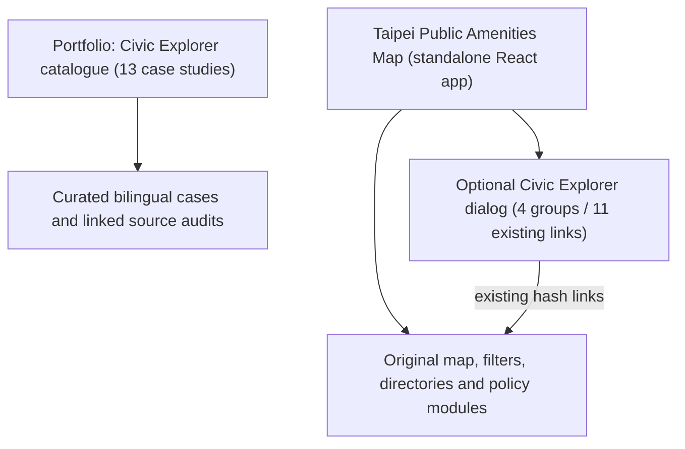
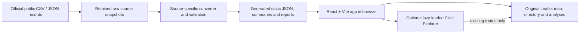

# Technical Capability and Architecture Overview

**Audience:** engineering interviewers and prospective system integrators. **Scope:** existing portfolio evidence, not a single production municipal platform.

## Demonstrated competencies

| Area | Implementation evidence | Boundary |
| --- | --- | --- |
| Public-data ETL and provenance | Source-specific scripts, validation, versioned static artifacts, documentary audits in source repos and Portfolio GovTech cases | Different source systems use different definitions; a common visual does not make their measurements comparable |
| Typed and reusable frontend navigation | Portfolio controlled React 18 Explorer; independent Public Amenities React 18 host adapter, 4 groups, 11 reviewed native hash targets | No shared package, enterprise design system or backend |
| Accessibility engineering | Semantic HTML list, labelled controls, dialog focus/Escape, reduced motion, desktop/mobile regression checks | No official accessibility certification; assistive-technology manual review remains separate |
| Reliability and reviewability | Scoped tests, CI when available, source identity, stable route contracts, PR review and dated validation | Local test results do not certify hosted behavior or operational SLAs |
| Policy/data interpretation | Case-specific assumptions, exclusions, non-applicable data and explicit no-go conditions | PoC is documentary decision support, not an operational recommendation or government mandate |

## Two related but separate Explorer implementations

**Important:** This diagram shows document/discovery relationships. Portfolio does not operate the Amenities Map as a backend, and the two Explorers have different host adapters and ownership.

## Public Amenities: build-time data and browser flow

Source-specific data assumptions and real-world availability must be stated at the individual module level. The Explorer changes navigation and presentation, **not** source acquisition, ETL, transformations, route meaning, GIS method or policy calculations.

### React integration contract

- Portfolio generic components: [API](../explorer-component-api.md); source at [src/components/explorer](../../src/components/explorer/).
- Source project's [Phase 2 documentation](https://github.com/LEO0331/taipei-bin-map/blob/0345c725c58d3a974ac1d72adbc6703ca652ee49/docs/civic-explorer-phase-2.md) and [merged PR #29](https://github.com/LEO0331/taipei-bin-map/pull/29).
- Source application owns `window.location.hash` and its allowlist; the optional dialog owns temporary Explorer state and leaves the map mounted during open/close.
- Real navigation to another route may still unmount the map under the original conditional-render design. Do not claim state retention across every route transition.
- List mode is the default; visual Scene is alternative presentation. Native links remain available.
- Licensing attribution for reused generic component is retained in the source repository.

## Case 001: research evidence, not an approval engine

[Case 001](https://leo0331.github.io/portfolio/govtech/bin-policy) links to the underlying [Public Amenities](https://github.com/LEO0331/taipei-bin-map) policy research. Its bin-allocation scenarios document weighted assumptions, source reconciliation, omitted inputs, method/snapshot identity and non-operational candidate interpretation. The analysis does **not** establish observed demand, public-health impact or municipal approval.

## Case 004: cross-source administrative evidence

[Case 004](https://leo0331.github.io/portfolio/govtech/urban-renewal) links to the [Real Estate Dashboard](https://github.com/LEO0331/taipei-real-estate-dashboard). It demonstrates source feasibility, incompatible statistical units, versioned snapshots, explanatory review tiers and bounded sensitivity tests. It does **not** infer an official urban renewal decision, building structural safety or building-specific priority from incomplete data.

## Architectural tradeoffs

**Why static-first:** Existing applications are public-data demonstrations; static JSON avoids inventing a runtime data platform. No agency data access, credentials, accounts, or real-time writes are implied.

**Why no central API:** The demo's objective is case navigation and explanatory review, not shared transactional state. Building a cross-project backend would expand scope and create false uniformity across source populations.

**Why independent repositories:** Ownership, verification versions, and interpretive caveats remain tied to each project. The Portfolio acts as a curated signpost, not a synchronized data warehouse.

**Why human verification:** Accessibility, data semantics and actual hosted behavior cannot be proved from one automated score or a successful source PR.

## Reviewer entrypoints

- [GovTech Explorer](https://leo0331.github.io/portfolio/govtech/explore)
- [Public Amenities Map](https://taipei-bin-map.vercel.app/)
- [Phase 2 verification](https://github.com/LEO0331/taipei-bin-map/blob/main/docs/civic-explorer-phase-2.md)
- [GovTech case portfolio and source-audit index](../govtech-case-study-v1.0.zh-TW.md)
- [Engineering evidence matrix](engineering-evidence-matrix.md)
