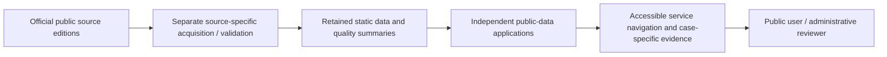

# Sample Technical Proposal — Public Data Discovery & Evidence Review PoC

**Status:** **Illustrative / non-client-specific draft**, 2026-11-11. This document is intended for scope discussion with a prospective SI partner or interviewer. It is **not** a tender submission, price quotation, service commitment, public authority endorsement or actual agency requirements specification.

## 1. Problem statement (hypothesis, not a confirmed client request)

Public administrative datasets are published with different schemas, dates, completeness and geographic assumptions. A service user may need to identify which data is available, understand its limitations and navigate to the right existing service directory or analytical view without confusing source-listed records with current service availability.

A small proof of concept can demonstrate **source-aware discovery**, **readable limitations** and **accessible navigation** without creating a new cross-agency data warehouse.

## 2. Candidate goals and non-goals

**Goals**

- Offer an accessible, bilingual thematic entry to agreed existing data-service modules.
- Preserve a source trail: providing authority, dataset/reference location, relevant edition and known exclusions, where supported by each existing module.
- Avoid making unsupported administrative or operational claims.
- Produce a verifiable handoff: architecture diagram, test cases, accessibility record, evidence matrix and limits.

**Non-goals**

- Operational case-management, dispatch, appointment booking or field-work authorization.
- Automatically approving policy interventions or ranking citizens, facilities or organizations by safety.
- Creating a central identity system, single shared back end or replacement for the source agencies' authoritative systems.
- Procurement estimates, security controls, production deployment, SLAs or support tiers before real project requirements are supplied.

## 3. Proposed bounded demonstration scope

| Workstream | Candidate delivery | Evidence-based example |
| --- | --- | --- |
| Information architecture | Reviewed thematic groups and accessible link targets | Public Amenities: 4 groups / 11 existing routes, with preserved hash navigation |
| Public data traceability | Source/edition and limitation annotations for selected modules | Source-specific ETL, publication/acquisition distinction and quality reports already documented by source projects |
| Accessible interaction | Keyboard-operable HTML list, focus management, responsive layout, language support | Existing Explorer implementation plus targeted host regressions |
| Quality assurance | Test matrix, baseline/after comparisons, documented manual review | Existing Vitest, Playwright, build and production-preview evidence |
| Handoff | Architecture, user journey, limitations and change log | Government Demo package and source-repository verification artifacts |

**Initial scope is a demonstration of existing integrations**. No new ingestion, automated approval, GIS prediction or data publication is promised.

## 4. Logical architecture

Source publishers retain data authority. Source applications own the transformations and data-specific caveats. The optional Explorer owns navigation only. The curated Portfolio case studies summarize bounded methods and refer back to the source repository.

## 5. Delivery stages and decision gates

| Stage | Activities | Exit evidence |
| --- | --- | --- |
| A — Discovery | Confirm business question, audience, authority, source list, usage constraints | Agreed use-case and data-inventory sheet |
| B — Evidence feasibility | Sample/inspect relevant source editions, missingness, definition and update information | Source registry; explicit unavailable-data list and no-go constraints |
| C — Minimal prototype | Implement only approved UI/data adapters, reuse existing host flows | Working limited demo, change list and source-to-view mapping |
| D — Acceptance | Unit/browser/accessibility review and source identity checks | Execution logs, recorded pass/fail, manual-accessibility outcomes |
| E — Handoff | Deliver documentation, evidence references and limitation register | Reviewed handoff package and responsibility matrix |

No implied timeline or fees are provided; both depend on client scope, external inputs and contractual arrangements.

## 6. Sample acceptance criteria (tailor to actual engagement)

1. Every demo destination is registered, accessible by keyboard and links to the intended existing module.
2. Opening/closing the optional navigation does not reset host controls or unexpectedly remount the map.
3. Users can navigate without visual-scene geometry using a semantic HTML list.
4. Each analytical result references the required source edition and clearly names material exclusions and unknowns; missing inputs are not silently converted to zero.
5. No user-facing copy presents the PoC as operational dispatch, an official approval process or a live service-quality guarantee.
6. Recorded checks identify exact code/data versions, commands, environment, failures and unresolved observations.
7. Any manual screen-reader review distinguishes performed, failed, passed and not-tested items.

These are **proposed example criteria**, not a claim of client approval.

## 7. Responsibilities / collaboration model (illustrative)

| Role | Potential responsibility |
| --- | --- |
| Agency / data owner | Define business question; authorize data usage and meaning; review whether outputs match administrative definitions |
| SI delivery lead | Requirements governance; integration scope; delivery review and contractual acceptance |
| Engineering implementer | Source mapping, typed UI adapters, accessible interaction, regression evidence, documentation |
| Domain/field reviewer | Investigate uncertain data definitions and real-world constraints not captured by public records |
| Acceptance owner | Record which criterion passed, failed or remains unverified |

No agency, SI or partner has accepted these roles for this independent portfolio work.

## 8. Risks and bounded mitigations

| Risk | Proportionate response |
| --- | --- |
| Stale or ambiguous published records | Show edition dates and unknown/unsupported fields; avoid real-time claims |
| Mismatched statistical units | Keep source populations separate; do not aggregate incomparable measurements |
| Map/navigation interaction regression | Preserve current routes and host state; add keyboard and browser regressions |
| Incomplete accessibility evidence | Keep semantic HTML fallback; record real manual observations and outstanding sessions |
| Scope creep into a generalized platform | Stop at approved use cases and explicit acceptance gates |

## 9. Evidence and handoff

See the [architecture](architecture-and-capabilities.md), [8-minute live demo](demo-script.md), [source-bound evidence matrix](engineering-evidence-matrix.md) and [accessibility review card](accessibility-verification.md).

For any real solicitation, replace this sample with confirmed user requirements, a scoped system boundary, actual deliverables, named stakeholders and contract-specific security/hosting/service arrangements. Avoid implying that this sample establishes procurement qualification.
