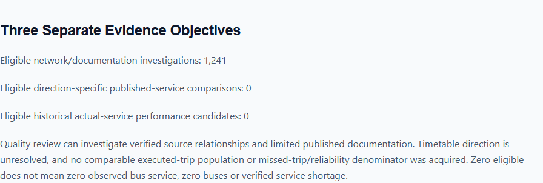
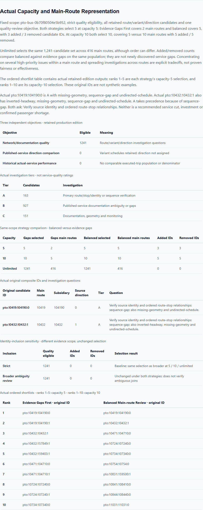
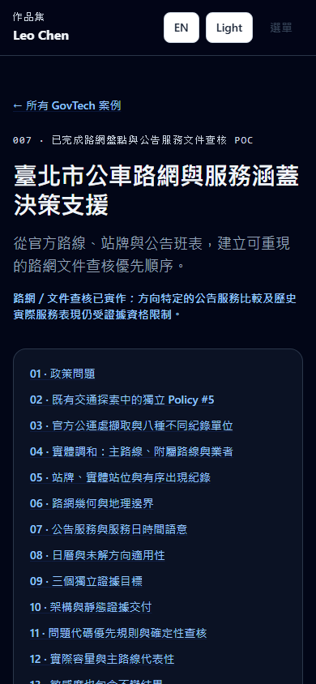

# GovTech Showcase v1.6 verification — 2026-10-22

> Maintenance note: One-off local plans, checkouts and runners referenced by this historical report were retired during repository cleanup. Recorded source identities, hashes, results and committed evidence remain unchanged. Temporary command arguments are descriptive placeholders, not claims that a new path was executed.

Branch: `codex/govtech-bus-service-case-007`. Portfolio base: `7c7ace1b97a334e0b618b78f7f018dc0c0a150bd`, fetched main including merged Vite8.3.5 PR #24 and Case006 PR #22. This feature does not introduce that dependency update. Scope is Portfolio only: no upstream writes, fresh official bus acquisition, ETL, all-route-detail download or runtime bus calculation.

## Audit, plan and baseline

Read AGENTS.md, both READMEs, feature ledger/progress/handoff, template and Case006/spec/audit/v1.5verification; inspected case/project types, shared renderer/normalizer/drawer, current data/localization/lazy routing, static SEO generation and tests. Clean working tree/recent history verified. Source PR9 merged metadata was confirmed before app edits. A dedicated branch, one scoped feature entry and pre-edit plan are recorded in a temporary pre-edit plan (retired).

Baseline2026-10-22 on Vite8.3.5: clean npm ci, harness17features,22unit,TypeScript/Vite build,105Playwright checks /17trackedflows(100%) and git diff --check passed. npm audit returned five existing high Tailwind/braces-chain package findings; the prior Vite finding is absent after the already-merged PR24. The local baseline report is retained under ignored a temporary verification workspace (retired).

Work resumed from saved source downloads and Neihu fixture after an account usage-limit interruption. Completed validation and saved artifacts were checked before reuse; they were not represented as newly acquired data.

## Independent bounded source validation

[Policy #5 PR #9](https://github.com/LEO0331/taipei-crash-map/pull/9) is merged at [e01b651d66cedfb5106c263088dc99fbc5d5e3b8](https://github.com/LEO0331/taipei-crash-map/commit/e01b651d66cedfb5106c263088dc99fbc5d5e3b8), overriding stale pre-merge text while retaining historical context. See [Portfolio source audit](./govtech-bus-service-source-audit.md) and [Chinese Case007 specification](./govtech-case-study-007.zh-TW.md).

Pinned snapshot `pto-bus-0b70f80504e5b952`; method `bus-network-service-evidence-review-v1`; schema/configuration `1.0.0`. Root public manifest exact bytes83,384 and SHA256 `00c1f33198ef811a46bddc784119063b2ce3174c5dbe3224ba0b662098d02b7b` were independently checked. The Git merge commit, snapshot edition and manifest digest identify different objects.

The independent cache script transpiles the original pinned pure utilities with the already-installed TypeScript dependency. It calls original manifest/snapshot assertions, verifies hashes/byte sizes before parsing four index/report bodies and only two representative route details (10132 and10419), checks artifact contracts/edition/route references, classifies all indexed candidates and runs original scenario/comparison functions. All420 referenced artifact contracts were checked; only six referenced bodies were downloaded/hashed, not all416details. Original compressed feeds were not reacquired or independently replayed through ETL. A checksum establishes agreement with the pinned manifest, not an official publisher signature.

Inputs, script and output stay ignored under a temporary source-replay cache (retired); independent report is `independent-validation.json`, reproducible with the historical one-off replay (runner retired) after retrieving the bounded pinned inputs. No cached upstream files ship to the Portfolio application.

| Official feed | Raw records / unit |
| --- | --- |
|GetRoute.gz|800 main-route/variant/operator rows|
|GetStop.gz|28,826 route-specific stop posts|
|GetStopLocation.gz|5,376 physical locations|
|GetPathDetail.gz|43,447 route-stop occurrences|
|GetSemiTimeTable.gz|3,280 published headway windows|
|GetTimeTable.gz|35,465 published timetable records|
|GetBusShape.gz|1,028 geometry metadata rows|
|GetSpecTimeTable.gz|282 special preplanned schedules|

Original acquisition is2026-10-21,5,586,935 compressed bytes; rebuild on22October is retained-input replay. Derived identity:416main routes,731subsidiaries,773distinct associations,27repeated association rows,212unresolved subsidiary references and216exact subsidiary/direction geometry matches. Stop/main-route,PathDetail/stop and stop/location references resolve in this edition. Cross-border scope is not district or population coverage.

## Real objectives, scenarios and examples

Independent original functions confirm1,241quality candidates: A163/B927/C151. Direction-specific published comparison has0eligible; actual historical performance has0eligible. Variant schedules are retained but lack accepted direction. No actual executed-trip population or completeness denominator exists.

| Capacity | Evidence gaps selected / main routes | Balanced selected / main routes | Balanced-only / gaps-only IDs |
| --- | --- | --- | --- |
|5|5 /2|5 /5|3 /3|
|10|10 /5|10 /10|5 /5|
|Unlimited|1,241 /416|1,241 /416|0 /0 (same set, ordering may differ)|

Actual composite example `pto:10419:104190:0` carries sequence-gap,undirected-schedule and missing-geometry; A sequence verification takes precedence over B timetable ambiguity and lower-priority geometry. Investigation asks for publisher verification of ordered route-stop relationships, not a service cut or shortage rating. Source data contains no passenger benefit or coverage-gap proof.

Strict and broader ambiguity inclusion each retain1,241quality candidates and identical selections at all tested capacities. Original comparison returns different evidence scope because the inclusion assumption changed; no population/selection effect is invented. Published-direction and historical objectives remain ineligible under both settings.

## Reused Portfolio integration

Existing GovTechCase/rule-based-priority/table renderer remains unchanged. Qualitative identity/source/sequence/eligibility rules replace any unrelated quantitative congestion thresholds. Seven cases reference five root projects. Crash Map retains its original accident and Neihu functionality,identity,URLs,image,stack/featured status and now owns006/007 in that order through its existing array. Bin001/005 and all other relationships/pins remain intact.

Case006 changes are limited to futureExtensions[1] and future.paragraphs[1] to acknowledge completed Case007. A complete frozen Neihu fixture compares every other field, including first evidence-requirement extension and engineering-chain paragraph. Current master/status/README/template text is corrected; prior delivery and verification reports are preserved. No new router,normalizer,dashboard,backend,dependency or source dataset download is added.

## Executed harness and final checks

Final integrated checks passed: harness18features,22unit tests,TypeScript/Vite8.3.5 production build,118/118Playwright checks and17/17trackedflows(100%),plus git diff --check. No standalone lint command exists; build includes TypeScript static analysis. No new dependencies or lockfile changes.

Actual production root and /portfolio builds each passed14bilingual case URLs with direct/refresh/canonical/language checks,locale navigation and unknown-slug noindex. Landing and EN/ZH bus pages passed320/390/768/1024/1440widths with no body overflow or page errors. Generated sitemap has24indexable routes. Main Pages JS312.72kB/100.63kB gzip; deferred case catalogue285.21kB/93.49kB gzip; CSS28.50kB/6.04kB gzip.

Full Neihu fixture regression permits only the two authorized completed-bus roadmap strings per language. Existing case fixtures, Bin001/005 and Crash006/007 links, stable pins, keyboard navigation and absence of runtime bus requests pass.

A mid-edit `C:/Program Files/Git/bin/bash.exe init.sh` attempt stopped at harness validation because README links referenced this verification document before it existed. This was an integration-order issue, not a passing full harness. The actual rerun after targets existed passed harness validation and npm ci, then stopped at npm audit with five existing high findings (exit1). Its downstream test/build commands passed separately as listed above. init.sh is not reported as fully passing.

| Executed command | Final outcome |
| --- | --- |
| npm run validate:harness | Pass,18features |
| npm ci | Pass,110packages installed |
| npm audit | Fail,5existing high package findings |
| npm run test:unit | Pass,22/22 |
| npm run build | Pass,TypeScript/Vite8.3.5/static route entries |
| npm run test:e2e | Pass,118/118 and17/17trackedflows |
| git diff --check | Pass |
| & 'C:/Program Files/Git/bin/bash.exe' init.sh | Fail at audit after harness/install; downstream commands run separately |
| Historical one-off source replay (runner retired) | Pass,bounded original-function evidence validation |
| Historical one-off production-browser verification (runner retired) | Pass,14bilingual URLs/5widths/zero page errors |
| Historical root-base production build in a temporary fixture | Pass,actual root build |
| node tools/generate-route-entrypoints.mjs (root fixture working directory) | Pass,24entries |
| Historical one-off production-browser verification (runner retired) | Pass,14bilingual URLs/5widths/zero page errors |
| Historical one-off documentation validation (runner retired) | Pass,26Markdown documents/235local links/18numbered specification sections |

## Visual evidence

All three source screenshots were inspected: Chinese desktop research dashboard,English mobile research dashboard and English selected-route stop-occurrence map showing37/37occurrences. They are upstream local previews, not government systems or independently accepted deployment. Eight local production captures document landing,case,objective gates,methodology,scenarios,Crash dual links and Chinese mobile light/dark. The [structured visual verdict](./govtech-v1.6-visual-verdict.json) is95/100,pass,using existing Case006 desktop/mobile styling as reference.

 No bus service map/dashboard is embedded in Portfolio.

## Verification boundaries, advisories and remaining risks

Upstream recorded results:99tests across7files,11bus/Neihu Pages integration checks,root/Pages builds,deterministic output checks,desktop/mobile review and actual JSON/CSV downloads. No new dependencies; source npm ci recorded two existing moderate findings. These recorded tests/builds are not independently rerun by this Portfolio task.

Recorded source performance: manifest83,384B +initial index563,601B =646,985bus JSON bytes before compression on tab entry;420references include416on-demand details,not one initial fetch. Lazy dashboard JS16.27kB gzip;max140selected-route map occurrences. Local Node balanced/10 mean0.3622ms over10,000iterations and one local read/parse32.8/11.2/4.4ms are not public internet/mobile guarantees. Portfolio does not fetch these payloads or run bus scenarios for visitors.

Current Portfolio audit has five existing high package findings (braces,chokidar,fast-glob,micromatch,tailwindcss),GHSA-vfj7-8cjw-p6xm. Vite8.3.5 was updated in the base PR24,not by Case007. Manifests/lockfile are unchanged in this feature. No standalone lint script exists; build runs TypeScript static analysis.

Missing accepted directional schedule assignment,actual operational history,calendar/geometry row freshness,passenger demand,walking access and population denominators remain limits. Network records and investigation diversity do not establish shortage,reliability,missed trips,equity,route-overlap inefficiency or benefits of cuts/investments. Independent personal POC,not government endorsement or procurement. Future source improvements require new auditable evidence; no operational claims are manufactured.

## Publication

Exactly one reviewable draft [PR25](https://github.com/LEO0331/portfolio/pull/25) was created against main,attached to this chat and verified open/unmerged. Implementation44a0e3b on codex/govtech-bus-service-case-007; Portfolio base7c7ace1b97a334e0b618b78f7f018dc0c0a150bd. No merge or post-merge deployment performed. Lifecycle-only follow-up records this publication; human review/manual merge recommended.
