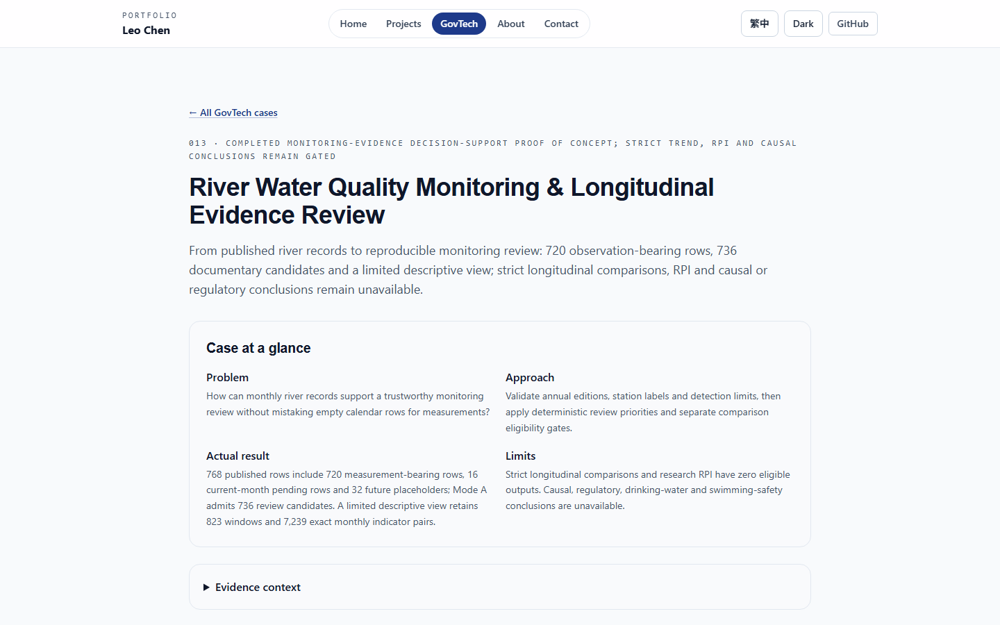
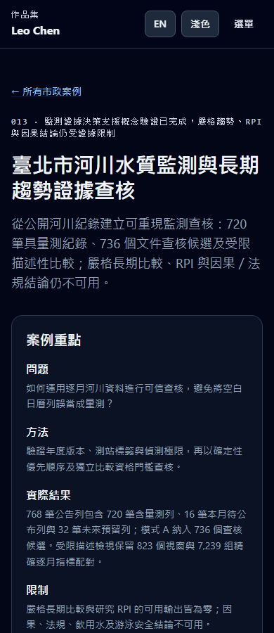

# Portfolio v2.5 — River monitoring Case013 verification

> Maintenance note: One-off local plans, checkouts and runners referenced by this historical report were retired during repository cleanup. Recorded source identities, hashes, results and committed evidence remain unchanged. Temporary command arguments are descriptive placeholders, not claims that a new path was executed.

Completed: **2026-10-28**, following source admission and baseline work on October27. Portfolio base: `8fa9a56acfddd3792efad63e49e6efbdc33343ad`, including merged Gridline completion PR39. Branch: `codex/govtech-river-water-case-013`. Source analysis remains fixed at **2026-10-27**, Asia/Taipei; resuming verification did not create a newer source acquisition.

## Dependency gate and baseline

[Policy13 PR7](https://github.com/LEO0331/taipei-feitsui-water-map/pull/7) merged at `beedd7eef3592c12bb66c21937add068f82ce5fa`, independently confirmed before Portfolio edits. The pinned source delivery document's uncreated-PR wording is stale historical administration. Actual merged code, accepted sources, snapshot, results, methods, tests and browser/performance reports were inspected before implementation.

Baseline: harness27 features, clean npm ci, zero Portfolio audit findings,29 unit tests,236 Playwright checks,17/17 tracked flows,TypeScript/Vite8.3.5 build and36 indexable routes passed. An actual unchanged production [baseline resource report](./evidence/portfolio-v2.5/baseline-pages.json) was captured before rebuilding the new application.

## Source evidence and independently reproduced results

The [source audit](./govtech-river-water-source-audit.md) and [compact fixture](../tests/fixtures/govtech-river-water-source.json) preserve the four ROC112–115 /2023–2026 resource IDs, update/acquisition times and original hashes. Four Big5/CP950 CSVs total109,553 bytes; four retained official contextual HTML bodies were also hashed. The accepted manifest is26,056 bytes with SHA256 fc0309d74b969a6855277f5ebbdf2da660a0104269efe85d7d17b4e2edb4062a.

Snapshot ID: `sha256-212d8dfb4b965163b6ff0edbb87765e87d933eac994f8d120de9d7b15a29dc81`. Exact immutable file:7,016,489 bytes, SHA256 `212d8dfb4b965163b6ff0edbb87765e87d933eac994f8d120de9d7b15a29dc81`. Method: `river-water-longitudinal-evidence-review-v1`; schema1.0.0. The Git commit, original CSV hashes, accepted-manifest hash and snapshot-file hash identify separate objects. This snapshot ID embeds its exact file digest by design; that is not a universal snapshot convention.

The [verifier](../tools/verify-river-water-source.mjs) transpiles unchanged original Policy13 TypeScript with the installed Portfolio compiler. Only the unchanged CSV function is AST-extracted from an unrelated preparedness module to avoid loading its GIS dependency. Original source auditing, four annual CSV parses/roster checks, two publication-disabled builders and the original hash/content validator reproduce identical bytes. Original scenario/export functions reproduce all six A scenarios, strict/limited B, C, scope/capacity comparisons and representative exports. Additional checks cover24 literal RPI boundary/gap fixtures, corrupted-hash rejection, mismatched-export replay, formula/control-prefix protection and original capacity5 exports(76,875-byte JSON /118,004-byte CSV). No source dependencies, source edits, remote publication or fresh official collection occurred.

|Evidence unit|Verified result and boundary|
|---|---|
|Published versus observed|768 published rows;720 measurement-bearing rows,all partial across27 fields;16 current-October pending rows;32 future placeholders|
|Historical revision|Old explorer656 observed /2026 old80; accepted720 /2026 new144. Both publish768 calendar rows; addition64 is not a count of new stations|
|Coverage|736 assumed through-cutoff opportunities;720 observed. Prior fully elapsed months720/720; current pending16 are not overdue samples|
|Station identity|16 river/station labels on9 rivers;15 current label matches,1 unresolved 青礜溪/菁礐溪. Historical physical continuity and policy coordinates remain unverified|
|Indicator cells|20,736 cells:10,684 exact,1,571 censored,7,185 not measured,1,296 blank;0 unparsed/invalid exact. No zero substitution|
|Mode A|736 eligible,32 future exclusions;A46/B690/C0. Review priority is documentary,not pollution severity|
|Mode B|1,296 station×indicator×adjacent-year windows;strict0. Limited823 windows/473 excluded,with7,239 exact monthly indicator pairs. Pairs are not independent samples or validated trends|
|RPI|460 potential exact four-input sets;0 admitted research outputs/all768 published rows excluded. Official literal thresholds exist,with precision/rounding/common-sampling evidence unresolved|
|Mode C|Unavailable;no causal,regulatory,drinking-water,swimming-safety or current public-health determination|

Both gaps-first and balanced strategies select the same five or ten A candidates at the small capacities,representing one river and one label. Actual IDs start `A:station-b304f8239c8754ee:2023-01` and continue monthly through May(capacity5) or October(capacity10). All-capacity sets contain736 IDs across9 rivers/16 labels. Default capacity5 overlap is5 shared/0 added/0 removed. Restricting2026 changes the population to160(A10/B150),−576;selected IDs become January–May2026,with0 shared/5 added/5 removed. This is a scope change,not a strategy effect or environmental improvement. Exact shortlists and complete-set digests are in the fixture; full lists remain pinned upstream.

## Portfolio integration and preservation

Added16 meaningful sections per language and12 source-backed tables through the existing GovTechCase,rule-based-priority methodology,shared renderer and case-specific lazy imports. The four-part overview exposes actual results and principal limits; exact IDs/source editions remain in closed technical tables. Public content has no PR/branch/handoff administration. Genuine pinned screenshots are accurately captioned: desktop provenance/export safeguards and Chinese mobile introduction.

The single Feitsui project now owns heavy-rain-preparedness and river-water-quality in that order. Case003 remains in Disaster Preparedness & Public Safety;Case013 belongs to Urban Services & Environment. The same root project can appear in both existing domain lists;there are still six domains and one project record. Flood and pollution evidence are separate. Homepage/domain/README/current-index copy now describes13 bilingual cases plus the independent Gridline Engineering Deep Dive. The final-collection template does not announce another case.

A compact prior-twelve semantic fixture protects all24 canonical localized records,including every source hash,snapshot,method,result and limitation. Nine protected Gridline/configuration files,the Gridline project record and Feitsui identity/URLs/image/stack/status are checked separately. Existing historical fixtures remain unchanged. Gridline technical content,featured order,pins and dependency files have no diff.

The shared page now reads the configured SEO title with the display title as fallback. This keeps Case013's requested shorter English SEO title aligned between static and hydrated HTML;all previous twelve configured titles equal their existing display titles. Both engineering routes remain untouched.

## Executed verification

|Command/check|Actual outcome|
|---|---|
|npm run validate:harness|Pass,28 feature records|
|npm ci|Pass,52 packages installed;dependency files unchanged|
|npm audit|Pass,0 Portfolio vulnerabilities|
|npm run test:unit|Pass,29/29|
|npm run build|Pass,TypeScript/Vite8.3.5 and38 indexable routes/static entrypoints|
|npm run test:e2e|Pass,249/249;0 skipped/flaky/unexpected;17/17 tracked flows(100%)|
|node tools/verify-river-water-source.mjs --source=<pinned-checkout>|Pass,8 original body hashes,two exact offline rebuilds and bounded original-function checks|
| Historical one-off production-browser verification (runner retired) |Pass,120 layout checks and31 direct/reload/static-title/canonical/language/404 outcomes|
|npx vite build --base /; adapted unchanged static-route/sitemap generators; browser.mjs with QUALITY_BASE=/|Pass,actual root build,38 sitemap URLs,120 layouts and31 route outcomes|
|npm run build (after root QA)|Default Pages build restored;both localized static canonicals and38-URL sitemap checked|
|git diff --check|Pass|

Initial clean installation encountered a Windows native-module lock held by a temporary preview;after that owned preview closed,the clean rerun passed. Initial new responsive testing exposed test setup issues:the loop ended in Chinese and the exact back-link name omitted its visible arrow. The test now uses the real language controls for the complete roundtrip and matches the actual accessible back link. No product locale behavior,assertions or checks were disabled. Interrupted work was resumed from inspected saved artifacts.

There is no standalone lint command. TypeScript compilation,harness,unit/static checks,public-presentation audits,semantic preservation tests and diff checks supply the supported static gate. Upstream92 tests,full init/build/browser reports and timings remain separately attributed recorded evidence;this Portfolio task does not claim a complete upstream suite/build rerun.

## Browser and visual evidence

[Pages report](./evidence/portfolio-v2.5/final-pages.json) and [root report](./evidence/portfolio-v2.5/final-root.json) cover320/390/768/1024/1440 widths in English/Traditional Chinese and light/dark themes. Surfaces include home,GovTech landing,Feitsui drawer,Case003,Case013 and Gridline. All240 layouts passed with no page errors,unexpected external requests,body overflow or broken checked images. Each base additionally passed31 route outcomes:all26 localized cases,two landings,two engineering routes and unknown-case noindex. Technical disclosures and table keyboard scrolling are exercised in E2E.

[Visual verdict](./evidence/portfolio-v2.5/visual-verdict.json):94/100,pass,against the established Case012/shared design. Actual source screenshots were inspected;no map markers or illustrative monitoring results were manufactured.

Detailed captures:[mode gates](./evidence/portfolio-v2.5/mode-gates.png),[actual scenarios](./evidence/portfolio-v2.5/mode-a-scenarios.png),[ordered selections](./evidence/portfolio-v2.5/ordered-selections.png),[RPI gate](./evidence/portfolio-v2.5/rpi-evidence-gate.png). Landing,shared drawer and root captures are retained alongside them. The [verification summary](./evidence/portfolio-v2.5/verification-summary.json) records final statistics and source replay scope.

## Measured resource cost

Encoded JavaScript response bytes from actual local production navigation,with font stylesheet blocking consistent across runs. These are resource measurements,not hosted latency,Lighthouse or availability claims.

|English route|Baseline bytes|Final Pages bytes|Change|
|---|---:|---:|---:|
|Home|104,337|105,074|+0.71%|
|Projects / shared drawer scripts|121,649|123,384|+1.43%|
|GovTech landing|125,364|127,397|+1.62%|
|Gridline engineering|121,848|122,586|+0.61%|
|New Case013|—|141,537|Dedicated lazy route|

Chinese Case013 loads141,797 encoded JS bytes. Root Case013 loads141,478 English/141,738 Chinese. Its dedicated scripts are42.60kB /12.42kB gzip(EN) and37.67kB /12.64kB gzip(ZH). Shared main JS275.36kB /87.54kB gzip. The7,016,489-byte source snapshot,original government files and test fixtures are not runtime dependencies. Recorded upstream local timings and export sizes remain in the separate source audit.

## Files,simplifications and remaining limits

New bilingual data,source verifier/compact fixture/prior-twelve baseline,E2E case,specification/source audit/this report and real browser evidence are present. Modified catalogue/summaries/lazy loader/types/routes/SEO,Feitsui project copy/relationship,domain/home copy,sitemap,existing count/link tests,README/template/current-index and lifecycle files. Existing renderer and project-link utilities are reused;no additional renderer,framework,backend or dependency was added.

Remaining limits are evidentiary:unverified historical station continuity and sampling methods,censored/missing fields,partial current year,RPI precision/rounding/common-event blockers and unavailable causal/regulatory outcomes. No fresh government acquisition,complete upstream application test/build,hosted deployment/Lighthouse,production availability or government endorsement is claimed. The collection is final at13 planned GovTech cases. Review the one Portfolio PR and merge manually;no automatic merge is performed.

## Publication

Exactly one reviewable draft [PR40](https://github.com/LEO0331/portfolio/pull/40) targets main on codex/govtech-river-water-case-013. Implementation commit5898329;Portfolio base8fa9a56acfddd3792efad63e49e6efbdc33343ad. The PR is attached to this chat and verified open/unmerged. A lifecycle-only follow-up records this status. Review and manually merge;no merge or post-merge deployment was performed by this task.
