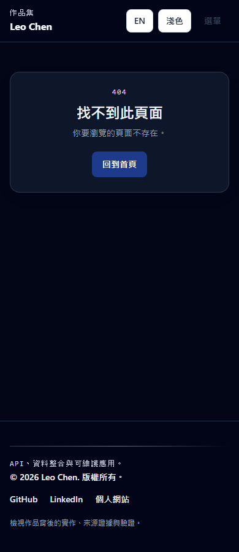

# Portfolio v2.6 — Final release audit

Audit date: **2026-10-28**. Starting main: `c2ee6e5893e45bce78508330f2c2c6490352a03f`, the verified merge of Case013 PR40. Branch: `codex/portfolio-v2-6-final-audit`. Verdict: **PASS_WITH_LIMITATIONS** for the locally verified candidate; candidate deployment remains a human-controlled follow-up.

## Scope and dependency gate

Case013 was confirmed merged before work began. The working tree was clean. The catalogue contains13 unique GovTech cases,26 localized records, display numbers001–013, six domains and38 unique project records. Gridline remains an independent engineering case. All40 registered routes are audited:38 indexable pages and two noindex error routes after the localized404 repair.

Case013 pins source `beedd7eef3592c12bb66c21937add068f82ce5fa`, method `river-water-longitudinal-evidence-review-v1` and fixed analysis date2026-10-27. Its immutable7,016,489-byte snapshot has ID `sha256-212d8dfb4b965163b6ff0edbb87765e87d933eac994f8d120de9d7b15a29dc81`. Eight retained original source bodies, two exact publication-disabled builds, scenario/RPI-boundary/export safeguards were independently replayed. No source repository was modified and no fresh government acquisition or complete upstream application suite/build is claimed.

Read AGENTS, README pair, lifecycle and feature state, route/catalogue/summary/project/featured/Gridline data, shared UI and utilities, tests/fixtures, quality/source tools and workflows. Historical v2.1/v2.2/v2.3/v2.5 reports supplied context; new baseline execution supplied current evidence. Code and security review skills supplied independent bounded review lanes. Findings and remediation plan were recorded before application edits.

## Phase A — Untouched baseline

The baseline passed clean npm ci, full npm audit with0 vulnerabilities,29 unit tests,249 Playwright checks,17/17 tracked flows, TypeScript/Vite build and38 indexable routes. Actual production browsing passed320 GovTech layout checks and29 route outcomes. Nine actual local Lighthouse mobile runs covered the six configured core routes plus bin, river and Gridline. A focused browser probe reproduced Chinese unknown-route language loss. Mocked maintenance regressions reproduced source corruption with approved dollar-bearing URLs before callback fixes.

The link baseline checked466 unique URLs with0 confirmed hard failures. Temporary network failures were retained as unavailable, not treated as deleted sources. Original baseline reports remain ignored local evidence; compact final evidence records the relevant measurements and uncertainty.

## Phase B — Confirmed findings and targeted fixes

|Finding|Severity|Resolution|
|---|---|---|
|FA-001 Chinese error routes became English and overwrote preference|P1|Added /zh/404, locale-preserving wildcard recovery, localized noindex/canonical/static metadata and visible recovery label|
|FA-002 Lazy content moved the initially visible footer|P1|Reserved viewport space in the existing loading fallback; delayed-script regressions verify footer position|
|FA-003 Accessible link names omitted visible CTA text or URLs|P2|Preserved visible text in Home/Hero/About/Contact names and localized shared navigation/footer labels|
|FA-004 Disaster-domain sentence repeated|P2|Removed only the duplicated English fire-access sentence|
|FA-005 Maintenance mutations interpreted dollar replacement tokens|P2|Used callback replacements at both property and whole-block insertion stages; mocked CLI/scan/pin/helper regressions preserve literal URLs and curated text|
|FA-006 Verification omitted engineering references and new research endpoints|P2|Extended existing bounded link/request audits; added three representative Lighthouse URLs, keeping one run per route|
|FA-007 Further image-size variants|P3|Deferred optional asset work; current measured image costs and opportunities are documented|

No P0 was found. Both P1 and all four P2 findings are resolved in the candidate; one P3 remains deferred. [Machine findings](./evidence/portfolio-v2.6/audit-findings.json) contain reproduction, expected/actual behavior, established root cause, changed files, verification and remaining risks. No case results were altered to make tests pass.

## GovTech and Gridline integrity

[Source integrity](./evidence/portfolio-v2.6/source-integrity.json) inventories each case's source SHA, snapshot/method and canonical semantic hashes. All26 canonical source files and protected Gridline/featured/pin files retain their recorded hashes(30 protected files). Existing historical fixtures remain intact. Project data, IDs, slugs, URLs, images, stack/status fields and dependency files have no diff.

Shared ownership remains Bin001/005, Crash006/007, Safety009/012 and Feitsui003/013. Case003 stays in Disaster Preparedness; Case013 stays in Urban Services & Environment. No duplicate project, seventh domain, new case or combined flood/pollution score was introduced. Gridline retains robotfriends compatibility, its current `e3d47a638ddb7f3192c63598596628f60c7b364d` pin and separate EN/ZH engineering routes.

Case013 still distinguishes768 published rows,720 observation-bearing rows(all partial across27 fields),16 current-month pending rows and32 future placeholders. Identity remains15 current label matches/one unresolved, with historical physical continuity unverified. ModeA736(A46/B690/C0); strictB0; limited823 windows/7,239 exact monthly indicator pairs. RPI has460 potential input sets but0 admitted outputs; ModeC is unavailable. Review priority is not pollution severity; limited differences are not independent samples, validated trends or causal/regulatory findings.

Gridline's local profile remains Node HTTP/SQLite-WAL with ingestion, provenance, health and persisted runs; the public demo remains static React/JSON. Its dated source-security graph remains separate from Portfolio's current zero-finding graph. A fresh read-only check of the frozen Gridline artifact still validates bytes and exact compact projection, but the current-session freshness check now blocks20 tickers because its latest price session is October26 while the review expects October27. Original October27 acceptance is preserved rather than rewritten or marketed as current coverage. No finance, banking, availability or production-SLA claim was added.

## Recruiter, localization and accessibility review

The first-screen role remains Backend-Focused Full Stack Engineer. Explicit featured order remains Gridline, Book QA Library and CraftFocus, with a separate GovTech collection entry. GitHub pins remain independent; all38 catalogue entries, search/filter/sort, details/deep links, Escape/focus recovery and legacy robotfriends links pass existing regressions.

Shared Chinese website/navigation labels are translated. The corrected names support visible-label matching in English/Chinese without changing visible CTA copy. Chinese404 now retains zh-Hant, stored preference, localized recovery and consistent static/runtime metadata. Keyboard tests cover skip/navigation, drawer controls, wide tables and disclosures; existing dark-mode contrast tests remain active. Nine final Lighthouse runs have weighted accessibility, best-practices and SEO scores of100, but this is not WCAG certification. Final label-in-name findings are zero. A small authentic screenshot supports the material error-page fix:

Other unchanged-page screenshots were deliberately not duplicated. The visual verdict is95/pass; the shared design and steady-state case layouts are preserved.

## Phase C — Verification and deployment bases

|Executed check|Final result|
|---|---|
|npm run validate:harness|Pass,29 feature records|
|npm ci|Pass, clean install|
|npm audit|Pass,0 vulnerabilities|
|npm audit --omit=dev --json|Pass,0 production findings|
|npm run test:unit|34 passed,0 failed/skipped|
|npm run build|Pass,40 registered static routes including two error routes;38 sitemap pages|
|npm run test:e2e|257 passed,0 skipped/flaky/unexpected;17/17 tracked flows|
|C:/Program Files/Git/bin/bash.exe init.sh|Exit0; the actual complete supported gate passed|
|node tools/govtech-link-audit.mjs (LINK_AUDIT_OUTPUT set)|Exit0,502 unique links,313 pinned paths exist,0 hard failures|
|node tools/verify-govtech-quality.mjs|Exit0,340 layout checks and31 GovTech/engineering route outcomes|
|Existing recruiter helper adapted to representative release surfaces|180 layouts on Pages and180 on root, all passed|
|All registered route checker|40 routes plus EN/ZH unknown recovery on each base:84 outcomes, all passed|
|Actual root build and static generators|Pass,38-URL sitemap, robots, canonical/title/description/lang/noindex and runtime WebPage schema consistency|
|Lighthouse 13.4.1 / Chrome 147|Nine baseline and nine final local mobile runs completed|
|git diff --check|Pass|

The default Pages build was restored after actual root generation/testing. Hreflang alternate tags are not implemented; locale navigation, document language and canonical behavior are verified without claiming such tags. [Route matrix](./evidence/portfolio-v2.6/route-matrix.json) includes all route metadata and outcomes. Layout counts are executed checks with overlapping page families:340 GovTech/engineering checks plus360 representative root/Pages checks. Every matrix uses320/390/768/1024/1440 widths, two locales and light/dark themes. No page overflow, broken checked images, duplicate IDs, missing checked captions or upstream research requests were found. Portfolio downloads neither GovTech snapshots/live government data nor a Gridline research dataset. Optional Google font styles/fonts are the only observed hosted third-party rendering resources.

There is no configured standalone lint command; TypeScript, harness, unit/browser/static checks and diff validation are the supported gate. New negative tests were preserved, not disabled. Maintenance writes run only in mocked temporary fixtures during testing; the actual catalogue was not synchronized or published.

## Measured performance

Same Lighthouse 13.4.1/Chrome 147 settings:one mobile412×823 simulated run per route,150ms RTT,1638.4Kbps and4× CPU slowdown. Part of baseline collection overlapped the large browser matrix; TBT and score differences therefore have single-run/load uncertainty. Independent delayed-script tests and direct layout-shift measurements support the footer fix. These are local observations, not production speed guarantees.

|Route|Performance baseline → final|CLS baseline → final|
|---|---:|---:|
|Home|92 → 92|0.00153 → 0.00153|
|projects|92 → 88|0 → 0|
|about|95 → 98|0.009441 → 0.008309|
|contact|95 → 95|0.013987 → 0.013143|
|zh|93 → 93|0.000172 → 0.000172|
|zh/projects|76 → 90|0.260024 → 0|
|govtech/bin-policy|74 → 88|0.272816 → 0.00053|
|govtech/river-water-quality|68 → 85|0.272816 → 0.00053|
|engineering/gridline|78 → 87|0.321633 → 0|

Home script transfer increased 105,884 → 106,095 bytes (+211, +0.20%); this includes HTTP transfer overhead. Image and stylesheet transfer costs stayed unchanged. Final Pages encoded script bodies total 105,285 bytes on home, 141,744 for English River013 and 122,796 for Gridline. The route remains lazy and the 7MB river artifact is never downloaded. [Performance comparison](./evidence/portfolio-v2.6/performance-comparison.json) records all categories, metrics and resource classes; remaining image opportunities are P3 rather than a new asset project.

Lighthouse CI now measures nine URLs instead of six, retaining one run and the existing action/workflow. The three additions are representative bin, River013 and Gridline pages. No new project dependencies or major upgrades were introduced.

## Link, security and CI/CD findings

[Link audit](./evidence/portfolio-v2.6/link-audit.json) separates structural/path/HTTP outcomes. All313 pinned GitHub paths exist; all local/internal checked destinations resolve. One mutable GitHub monorepo URL is a reachable project repository destination, not a technical proof link. One Render demo timed out under the bounded8-second audit; an anonymous browser retry returned503 Application loading. It remains operationally unverified, not deleted. The three featured demo landing pages returned200 and rendered titles/content; configured API, account and business workflows were not accepted by that check.

[Security/CI review](./evidence/portfolio-v2.6/security-ci.json):0 findings in full and production npm audits,280 tracked code/configuration files scanned with no matching secret patterns, and15 remote action references pinned to commit SHAs. React escapes public content; query IDs select curated records; external links retain safe protocols/noopener behavior. CSP limits executable scripts and connections to self, with explicit Google font allowances. This bounded review is not a repository-history/account-secret or upstream-service security certification.

Deployment runs install/build/static generation and Pages artifact deployment. E2E and Lighthouse are separate PR/main workflows; their success is not a proven dependency of deployment. Monthly maintenance verifies harness/unit/build/E2E/diff before its review PR and reports audit advisories separately. Permissions/triggers, artifact uploads, failure propagation and non-force-pushed maintenance review behavior were inspected. Branch-protection settings were not independently established. Build/E2E/Lighthouse use their existing Node 20 setup; maintenance and source-link tooling use Node 24; all commands in this local audit used Node 24.14.0. No unsupported combined release-gating claim is made.

## Hosted main versus candidate

[Hosted verification](./evidence/portfolio-v2.6/hosted-verification.json) records actual main `c2ee6e5`:deployment, E2E and Lighthouse workflows each completed successfully at that SHA. Main HTML loads baseline hashed assets; Case013 and both Gridline routes, language navigation, styles, sitemap and robots were observed. Console page errors were zero. One lazy catalogue image request was aborted during navigation; no persistent broken image was established.

Current hosted main still reproduces the old Chinese404 behavior; the local candidate fixes it. Candidate audit changes are **not** claimed live. After human review/merge, confirm the deployed head/assets, EN/ZH404 recovery, Case013/Gridline links and independent E2E/Lighthouse outcomes. No automatic merge or source repository change was performed.

## Readiness and maintenance boundary

**PASS_WITH_LIMITATIONS**:all declared local acceptance gates pass and no candidate P0/P1 issue remains. Remaining limitations are candidate hosted verification after human merge, the inconclusive Render service, one-run Lighthouse uncertainty, optional image work and intentionally historical upstream research evidence. None is mislabeled as a passing production or scientific gate. See the [release-readiness report](./portfolio-v2.6-release-readiness.md) for the concise decision and post-merge checklist.

Freeze new GovTech policy development at13 cases. Future Portfolio work is limited to security/dependency maintenance, broken-link/compatibility fixes, material factual corrections and concrete recruiter feedback. No additional policy, domain, renderer or featured-project framework is introduced.

## Review publication

Exactly one draft [PR41](https://github.com/LEO0331/portfolio/pull/41) targets main from codex/portfolio-v2-6-final-audit. Implementation commit:d9b8de3;starting main:c2ee6e5893e45bce78508330f2c2c6490352a03f. It is attached to the chat and verified open/unmerged. The publication-only follow-up records this state;candidate hosted deployment and independent CI acceptance are not inferred from local verification. Human review and manual merge only.
