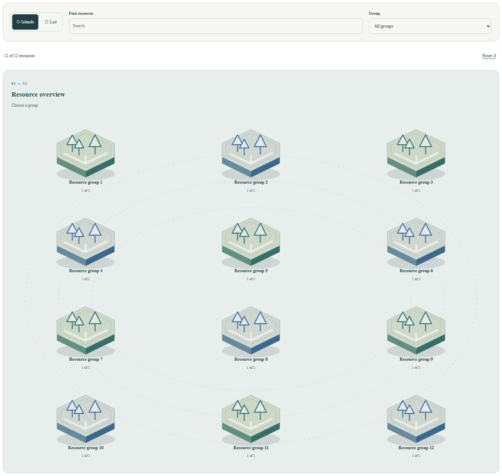

# Civic Explorer v3.0.1 stabilization

Completed **2026-10-29**. Verdict: **PASS_WITH_LIMITATIONS** for the locally verified candidate.

Merged v3.0 [PR 42](https://github.com/LEO0331/portfolio/pull/42) was independently confirmed before stabilization. Exact baseline: `7743cf6f78876da218c2a9d497fe38adb420f6cf`. Work continues on the single isolated branch `codex/portfolio-v3-0-1-stabilization`, resuming implementation commit `61322ac` rather than duplicating its completed extraction. No other repository, dependency, canonical case evidence, analytical claim or recruiter positioning was changed.

## Actual baseline and audit

A fresh detached checkout of merged v3.0 was installed, built and tested before the completion edits. Harness, clean `npm ci`, `npm audit` (zero findings), 37 unit tests and 269 Playwright tests passed; tracked-flow coverage was 17/17. Browser concurrency was explicitly bounded to two workers for both baseline and candidate. Historical October 28 reports were reviewed as prior evidence rather than substituted for this new baseline.

The existing branch had already reproduced and fixed five concrete v3 defects, with failing-before tests retained in [confirmed regressions](./evidence/portfolio-v3.0.1/confirmed-regressions.json):

1. Mobile CSS displayed details before the browser while DOM/keyboard order placed them afterward.
2. Closing after a view change lost focus instead of returning to the same case in the current view.
3. History-driven dismissal lost focus; deliberate search edits needed to retain input focus.
4. Selecting a domain by keyboard removed the focused hub without announcing/focusing the new scene heading.
5. Evidence/list links and disclosure summaries had undersized mobile touch targets.

The existing branch also repaired real nested scene clipping: the dated production probe showed a360px island surface inside286px/356px scene containers at 320px/390px. Width constraints now follow the available container. Rapid view/dismissal updates merge with the latest browser URL so newer state is not overwritten by a stale render. The original layered geometry, colors, hover/focus transitions and reduced-motion behavior remain preserved.

Completion review found and fixed two additional reusable-host issues:

- Runtime coordinate validation accepted empty, short, long and sparse tuples. It now requires exactly two finite coordinates in 0–100 for either optional layout. The added unit regression failed on the old validator and passes for every malformed case and valid boundary pair.
- Automatic many-group overviews could overlap painted labels/captions in a wide single-column host. Multi-row automatic group layouts now reuse the bounded plinth width. A real twelve-group fixture failed before the fix; all 24 label/caption targets pass afterward. Explicitly positioned Portfolio islands retain their reviewed layout.

No cosmetic redesign or basic card-grid replacement was introduced.

## Component and data boundaries

Generic code lives in `src/components/explorer`:

- `InteractiveExplorer` owns controlled composition, live counts, panel shell, Escape and semantic focus restoration.
- `ExplorerScene`, `HexIsland` and scoped CSS render original layered SVG/CSS geometry with ordinary HTML buttons.
- `ExplorerControls` and `ExplorerListView` supply native controls, complete nonvisual HTML navigation and real anchor targets.
- `types.ts` defines nodes, groups, visual configuration, labels, search configuration, callbacks and optional render slots.
- `model.ts` validates constructed models, filters literal search terms and preserves ordered node references.

Generic components import only React and sibling generic files. They require neither GovTech data, React Router, a Portfolio locale provider, Tailwind nor a backend. The existing `civic-*` CSS namespace is retained for visual compatibility; it is not a data dependency.

`govtechExplorerAdapter.ts` is the Portfolio boundary. It derives thirteen nodes and six groups from existing case summaries, overview tuples and explicit primary-domain mapping. It preserves separate case IDs when repositories are shared, including Feitsui Cases003/013. It supplies bilingual labels, existing evidence/maturity content and deployment-base-safe canonical case targets. No long case descriptions or policy claims are duplicated.

`GovTechExplorerPage` retains router/query/locale/SEO integration. `ExplorerDetailPanel` retains selected-case-only evidence loading and original case content. Generic slots receive node identity and close/heading controls; IO, authorization, source freshness and host navigation remain outside the generic renderer. The prior civic scene/list implementations were replaced rather than retained as competing renderers.

The complete typed API, example props and host responsibilities are documented in [Explorer component API](./explorer-component-api.md). Native navigation is preserved for modified clicks; the optional callback intercepts only unmodified explicit navigation. Scene selection calls the selection callback. Stable IDs support focus return across scene/list/history changes and multiple component instances.

## Reuse acceptance

The independent `tests/fixtures/explorer-host` entry is built as plain React without Portfolio routing, locale, civic data or Tailwind. It exercises:

- Five unrelated resources and ordered groups.
- Thirteen resources with a twelve-node selected group.
- Twelve automatic groups in a full-width overview.
- Search, selection, reset, callbacks, native anchor behavior and optional details.
- Multiple instances with unique accessible IDs.
- Small touch layouts, larger desktop row budgets and actual painted label/caption hit targets.

This is test evidence, not an implementation in another repository. The generic folder is **ready for a second-repository integration trial**. The target dashboard still needs reviewed adapters/URLs, React and CSS-build compatibility, real data, routing/theme/security integration and its own browser acceptance. No npm package is published.

## Fresh verification results

|Executed command/check|Actual result|
|---|---|
|`npm run validate:harness`|Pass; 31 feature records before completion marking|
|`npm ci`|Pass; no dependency-file changes|
|`npm audit`|Pass; 0 vulnerabilities|
|`npm run test:unit`|43 passed; 0 failed/skipped|
|`npm run build`|TypeScript/Vite pass; 42 registered routes,40 indexable|
|`npx playwright test --workers=2`|281 passed; 0 skipped/flaky/unexpected|
|`node tools/e2e-coverage-check.mjs`|17/17 tracked flows|
|Focused generic and stabilization browser checks|12 passed after the completion fixes|
|`node tools/verify-civic-explorer.mjs`|Pages 80 states/44 route outcomes pass|
|Actual root Vite build and unchanged static generators|Root 80 states/44 route outcomes pass|
|Restored `npm run build`|Default Pages build restored|
|`git diff --check`|Pass after final formatting gate|

The matrices cover320/390/768/1024/1440 widths, English/Traditional Chinese, light/dark and overview/domain/selected/list states. They verify source counts, every visible label/caption hit target, body and nested-scene overflow, duplicate IDs, canonical metadata, direct/reload behavior, all registered routes and unknown-route recovery. Final page errors and unexpected external requests are zero.

All 51 protected source/presentation hashes match merged v3.0. The homepage, backend positioning, Gridline engineering case, all thirteen bilingual cases, projects/filters, source evidence, canonical routes, dependencies and v2.6 error/layout fixes remain preserved. The current desktop overview screenshot is byte-identical to the fresh v3.0 local capture under the same settings. Tests retain meaningful negative paths and were not weakened to obtain a pass.

The authoritative resumed results and paired observations are in [completion verification](./evidence/portfolio-v3.0.1/completion-verification.json). Earlier October 28 evidence remains dated prior work; it is not represented as a fresh final gate.

## Actual performance comparison

Both fresh local stages used the same existing measurement tool, fresh browser context per sample, light theme, reduced motion, optional font stylesheet blocked consistently,900px height and 4×CPU slowdown. Each stage has18samples:390px and 1440px, three routes and three runs each. Medians describe observed local navigation/render/interaction work; they are not official INP, React profiling or a statistical production-speed result.

|Route|v3.0 encoded JS|Final encoded JS|Difference|
|---|---:|---:|---:|
|Homepage|105,592B|105,573B|−19B; essentially unchanged|
|Explorer overview|133,589B|135,067B|+1,478B(+1.11%)|
|Selected River evidence|145,955B|147,433B|+1,478B(+1.01%)|

The lazy Explorer script grows17,529→21,384raw bytes(+3,855B); route CSS grows9,455→10,631B(+1,176B). This is an explicit cost of independent scoped styling and reusable/focus behavior, not a claimed payload optimization. The selected case still adds only its own evidence chunk; generic-host scripts contain no civic/Gridline/locale runtime chunks. No Three.js, WebGL, animation dependency, upstream snapshot or live government API is added.

Timing results are mixed and are reported candidly. At390px, overview median FCP 288→364ms, observed search-to-painted-result86.5→103ms and selection107.7→136.2ms. At1440px, the corresponding values are296→328ms,83.7→93.3ms and 109.2→140.6ms. Homepage FCP also varied despite protected homepage source. Initial CLS is0in all paired groups; local application console warnings/errors are0. These three-sample,4×CPU observations do not establish a general speed improvement or a production regression/guarantee.

## Visual and production scope

The fresh desktop overview, Chinese mobile dark selected view and independent twelve-group host were visually inspected. Original depth, hierarchy, focus and readable controls are retained. [Completion visual verdict](./evidence/portfolio-v3.0.1/completion-visual.json):95/pass. Existing representative captures remain in this evidence directory; only the new many-group finding needs an additional image:

Fresh production rendering on October 29 was attempted with both the existing Playwright probe and the available in-app browser. Both were blocked by `net::ERR_NETWORK_ACCESS_DENIED`; no fresh rendered-site pass is claimed. GitHub deployment metadata independently confirms successful deployment of merged main 7743cf6 ([run](https://github.com/LEO0331/portfolio/actions/runs/40699814758)). The earlier October 28 production behavior/width evidence remains separately attributed. The stabilization candidate is not deployed until human review and merge.

## Remaining limits and delivery

Verdict **PASS_WITH_LIMITATIONS**:current local acceptance passes, reviewed Portfolio visuals/data are preserved, and the typed generic component contract is backed by an independent host. Fresh production-browser access, full assistive-technology/WCAG certification, other browser engines/React versions and actual second-repository acceptance remain unverified. Three local timing samples are not statistically established performance claims. Explicit custom positions and target URLs remain host responsibilities.

One Draft PR is delivered from this feature branch. Review and merge manually; after deployment, verify the selected/list/mobile flows and independent CI results on the actual hosted candidate. No automatic merge, another repository integration, new policy/dataset or package publication is performed.
